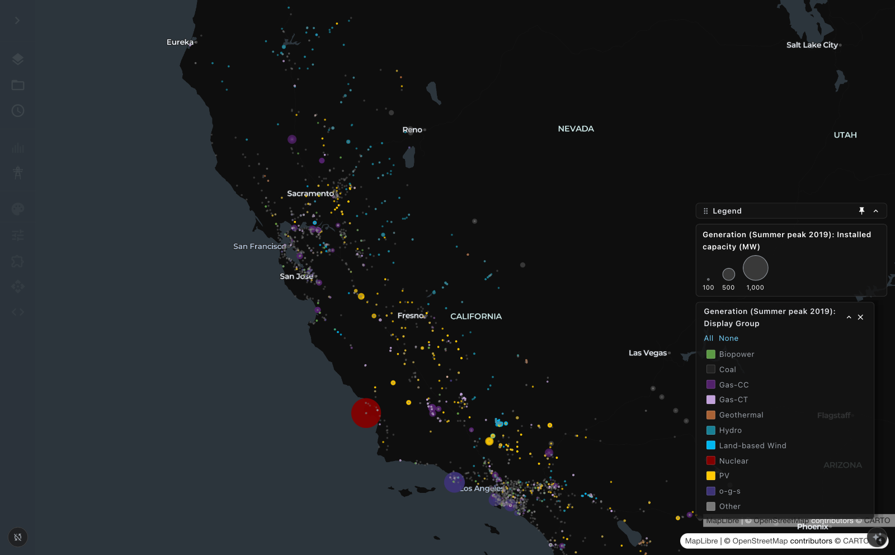
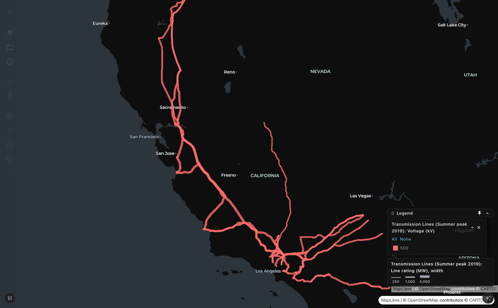
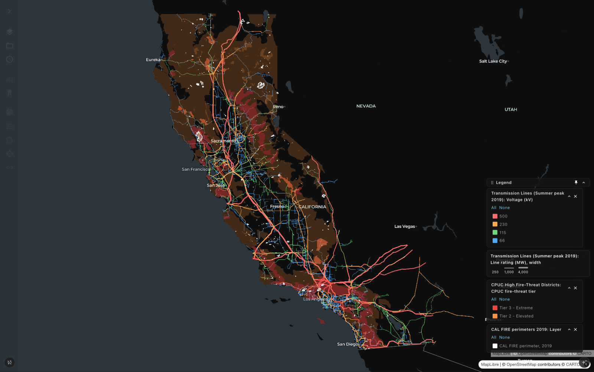
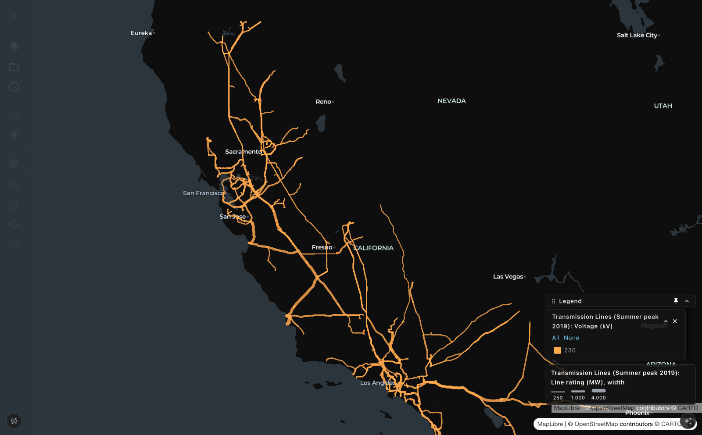
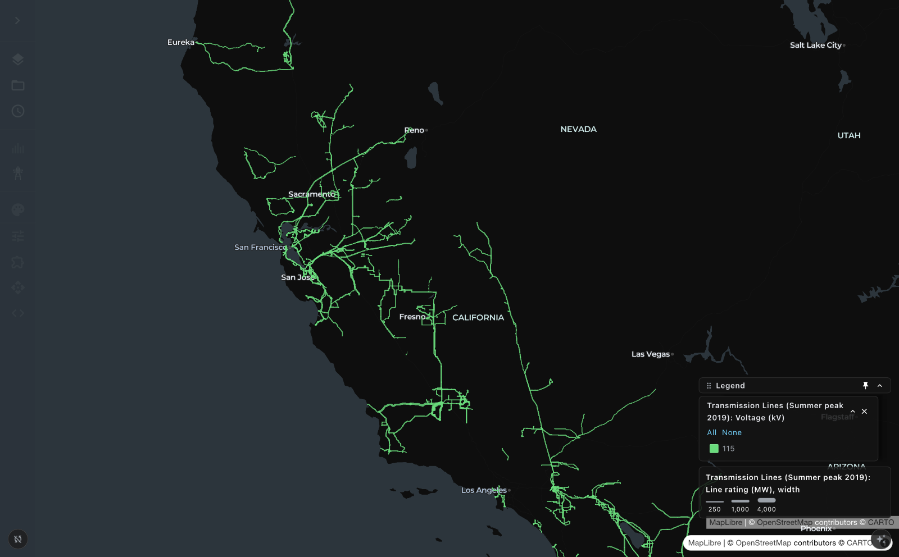
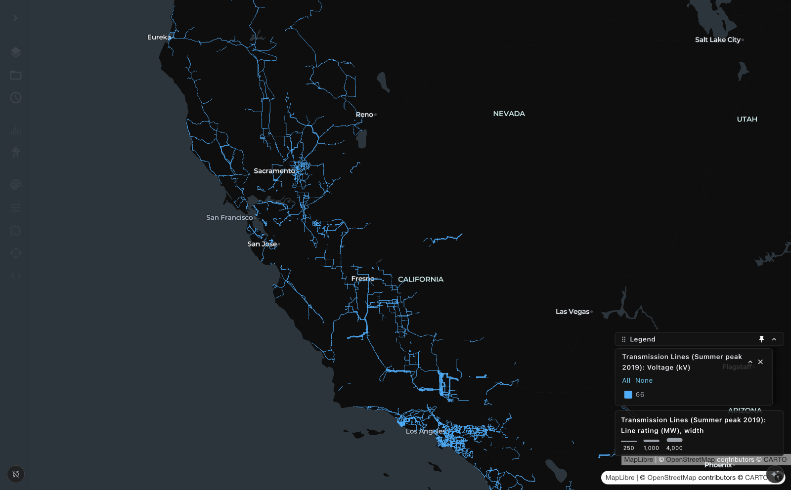
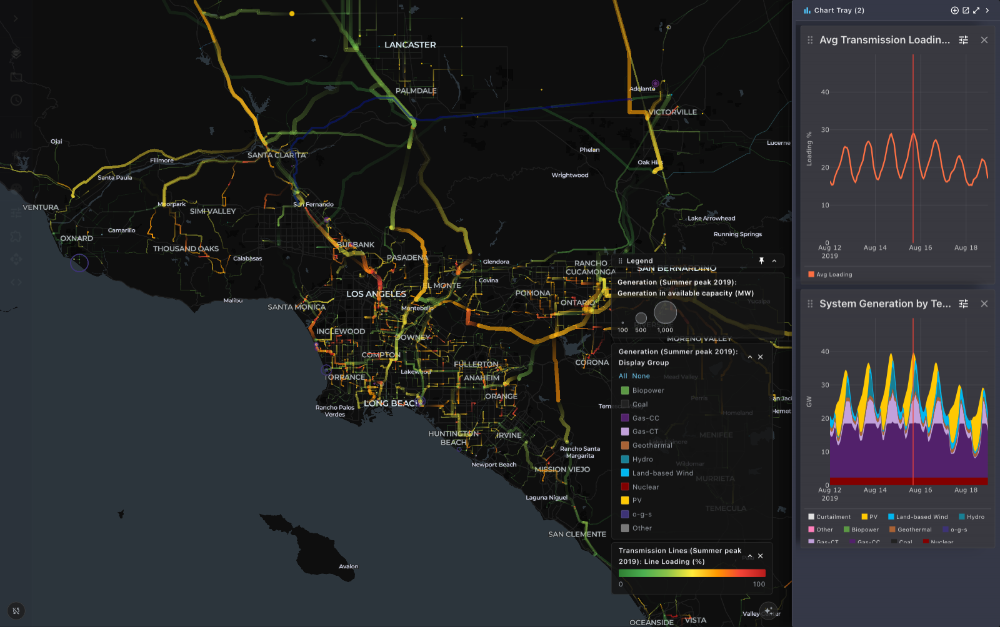

# GridSight

**Let an AI agent build your grid visualizations. Keep the result as a story anyone can replay.**

GridSight is a desktop app for power-system data on a map: generators, lines, loads and their
hourly results, animated over time. It is built for agents. Claude, or any other
[MCP](https://modelcontextprotocol.io) client, can load a scenario, style every layer, bring in
data from other sources, check its own work with screenshots and error logs, and save each view
as a chapter of a story. You get the configuration-heavy, publication-quality view without the
configuration.

Use it [with Claude Desktop on your Claude subscription](#with-claude-desktop-on-your-claude-subscription)
(no API key), [with local or open-weight models](#with-local-or-open-weight-models) when your data
must stay in-house, or [with no agent at all](#without-an-agent).

<p align="center">
  
  <br><sub>An agent-built story about CATS, the California Test System. Chapter 7 is a screen recording of the week playing in the app; the other chapters change every 4 seconds;
  <a href="#a-story-built-by-an-agent-one-week-of-summer-peak-in-california">see all chapters below</a>.</sub>
</p>

> **Looking for GridSight classic?** The original GridSight lives on the
> [`classic`](https://github.com/NatLabRockies/GridSight/tree/classic) branch
> and the [`v0-classic`](https://github.com/NatLabRockies/GridSight/tree/v0-classic) tag.

## A story built by an agent: one week of summer peak in California

This story uses [CATS](https://github.com/WISPO-POP/CATS-CaliforniaTestSystem), a synthetic grid on
California's real geography (8,870 buses, 10,823 branches, 3,892 generators), with one week of
hourly economic dispatch from [Sienna](https://github.com/NREL-Sienna) (PowerSimulations.jl).
An agent built every chapter through GridSight's MCP tools: it styled the layers, opened the
charts, checked each view with `capture_view`, and saved it. Every option it used is also in the
layer styler, so you can change any chapter by hand.

| | |
|---|---|
|  |  |
| **1. Generation capacity.** Each circle is a plant, sized by installed MW and colored by technology. | **2–5. Lines by voltage.** One chapter per class (500, 230, 115, 66 kV); width shows the thermal rating. |
|  |  |
| **6. Data from another source.** The agent added the CPUC High Fire-Threat District map and CAL FIRE's 2019 fire perimeters: about 10% of CATS line length is in Tier 3. | **7. The week, hour by hour.** Recorded in the app: line loading and generation animate, and the chart tray (generation by technology, demand) follows the clock. |

<details>
<summary>More chapters: 230, 115 and 66 kV, and the peak hour</summary>

| | |
|---|---|
|  |  |
| **3. 230 kV:** 1,258 lines tie the backbone to the load centers. | **4. 115 kV:** 2,209 lines distribute power within each region. |
|  |  |
| **5. 66 kV:** 6,565 lines, more than half of the network. | **8. The peak hour:** Thursday 15 August, 16:00, 39.7 GW. Most heavily loaded lines are in the Los Angeles basin. |

</details>

**Try it:** [`examples/cats-sienna`](examples/cats-sienna) makes the simulation data with Docker. Load
it with the GAT extension, then import
[`examples/cats-sienna/story/cats-summer-peak.json`](examples/cats-sienna/story/cats-summer-peak.json)
with **Import** under the story picker in the sidebar (or ask your agent to `import_story` and play
it).

## Three ways to use GridSight

### With Claude Desktop on your Claude subscription

The recommended setup. Claude Desktop (or Claude Code) controls GridSight through MCP and uses your
Claude plan, so you need no API key and pay no per-token API charges.

1. Install [Claude Desktop](https://claude.ai/download) and sign in with your Claude account.
2. In GridSight, open **Agent Integration** in the sidebar and choose **Auto-configure Claude
   Desktop**. This adds a `gridsight` entry to `claude_desktop_config.json` and changes nothing else.
3. Quit Claude Desktop fully and open it again. Keep GridSight open while you work.
4. Ask Claude: *"What scenarios are loaded in GridSight?"* or *"Show installed capacity by
   technology."*

The CATS story above was built this way. With this setup, the data that Claude reads (query
results, layer properties, screenshots of the map) goes to Anthropic under the terms of your Claude
plan. For data that must not leave your organization, use the next option.

### With local or open-weight models

For sensitive data, such as utility customer data or internal studies, run the model yourself.
The data engine (DuckDB) and the app already run on your machine.

- **Built-in AI chat.** GridSight finds [Ollama](https://ollama.com) on `localhost:11434` by itself.
  For a [LiteLLM](https://docs.litellm.ai) proxy, vLLM, or any other OpenAI-compatible server
  (for example one that serves open-weight models for your organization), set
  `CUSTOM_LLM_BASE_URL`. The desktop app reads it from a `.env` file in its data folder; see
  [AI chat setup](#ai-chat-setup-optional).
- **MCP.** Any MCP client that runs a local model can use the same tools as Claude: point it at the
  command that **Agent Integration** shows.

Use models that support tool calling. Smaller local models make more mistakes on long tasks, so
start with short requests ("show only the 500 kV lines") and let the model check its work with
`capture_view`.

### Without an agent

Everything an agent does, you can also do by hand: the layer styler, filters, charts, the clock,
perspectives and the story editor are normal parts of the app. No AI is needed: the chat appears
only when a model provider is set up (or Ollama runs on your machine), and agents connect only
through MCP if you add them. The cost is time: there are many style options, so a view like
the CATS chapters takes many clicks. An agent sets the same options for you, and you can then
adjust them in the styler.

## How it works

1. **Load a scenario.** Extensions bring in data: [GAT](https://github.com/NatLabRockies/GridAnalysisToolkit)
   reads Sienna and PLEXOS results; you can also add GeoJSON, CSV or Parquet files.
2. **Connect an agent (optional).** In the app, open **Agent Integration** in the sidebar and
   choose **Auto-configure Claude Desktop**, or copy the command for another MCP client. The app
   also has a built-in AI chat for local models (Ollama, LiteLLM, vLLM) or cloud APIs.
3. **Ask for what you want to see.** "Show installed capacity by technology." "Only the 500 kV
   lines, width by rating." "Add the CPUC fire-threat map and tell me which lines cross Tier 3."
4. **The agent checks its own work.** It can see the map (`capture_view`), what the map draws
   (`inspect_layers`) and every error from the app, including failed charts and SQL errors
   (`get_errors`). It corrects itself before it shows you the result.
5. **Save it as a story.** Each view becomes a perspective; a story puts them in order with
   narration. Stories replay without AI and can be exported as one JSON file to share.

## Key features

- **Agent-first, through MCP.** About 50 tools: load data, query it with SQL, style and filter
  layers, control the map and the clock, make charts, and save perspectives and stories.
- **Power-system layers.** Generators with generation inside available capacity; transmission
  lines with animated loading and flow direction, or a static capacity view colored by voltage.
- **Time-series animation.** Hourly results stream by day and play smoothly, with optional worker and GPU paths for large systems.
- **Your data, your models.** Local DuckDB engine. Use Claude on your subscription, local or
  open-weight models through Ollama or LiteLLM, or no AI at all.
- **Extensions.** Pip-installable Python packages add data sources, controls, charts and shaders.
- **Data lineage.** Every query, control change and saved view is tracked.

## Install the desktop app

The desktop app is the main way to use GridSight. It bundles the server and the web UI; at first
launch it sets up its own Python environment.

1. Download the installer for your platform from
   [Releases](https://github.com/NatLabRockies/GridSight/releases/latest):
   `.dmg` (macOS, Apple Silicon), `.exe` or `.msi` (Windows).
2. **macOS:** open the `.dmg` and drag **GridSight.app** to Applications.
   The app is not signed with an Apple Developer ID, so on first launch:
   - macOS 14 or earlier: right-click GridSight, choose **Open**, then **Open**.
   - macOS 15 or later: run `xattr -dr com.apple.quarantine /Applications/GridSight.app` once, then open it.
3. **Windows:** run the installer. SmartScreen warns that the publisher is
   unknown; click **More info → Run anyway**.
4. **Power-system data:** install the GAT extension from **Extensions** in the app (see
   [`docs/extensions.md`](docs/extensions.md)).

To build the desktop app from source, see
[`docs/desktop-building.md`](docs/desktop-building.md). To serve GridSight to a team from one
host, see [Run with Docker](#run-with-docker).

## Architecture

```
gridsight-sdk        (pip package — extension interfaces & data models)
      | implements
my-extension         (pip package — entry_points: gridsight.extensions)
      | discovered by
gridsight-server     (FastAPI backend)
  |-- ExtensionRegistry  — discovers extensions via importlib.metadata
  |-- DuckDBEngine       — in-memory analytical SQL engine
  |-- AI Chat            — provider-agnostic LLM with tool use
  |-- LineageManager     — data provenance tracking
  |-- SQLite ORM         — projects, scenarios, layers, perspectives
  '-- API routes         — data, controls, charts, shaders, search
      | serves
web frontend         (React + deck.gl + MapLibre + Material UI)
  |-- Animation engine   — TimeseriesBuffer drives animated layers
  |-- Entity interaction — dynamic controls, charts, info cards
  |-- Shader registry    — lazy-loads extension GLSL/JS modules
  '-- Chart registry     — maps chart types to React components
```

At startup, the server discovers all installed extensions, calls `get_manifest()` and `on_startup()` on each, registers their DuckDB tables, syncs their projects/scenarios/geometries/datasets into the ORM, and creates default layers.


## Concepts

| Concept | Description |
|---------|-------------|
| **Project** | Top-level container for related data, often spanning multiple modeling tools. |
| **Scenario** | A data collection within a project. Scenarios can be hierarchical (parent/child). |
| **Layer** | Binds geometry to a deck.gl layer type with dataset joins and style mappings. |
| **Painting** | A named style snapshot for a single layer — opacity, colormap, filters, scales. |
| **Perspective** | A collection of paintings, plots, map state, and animation state that captures an analytical view. |
| **Story** | A sequence of perspectives with transitions and narration for guided analysis. |


## Run with Docker

Use Docker to serve GridSight to a team from one host:

```bash
cp .env.example .env          # extension creds, AI keys, …
./scripts/docker-build.sh     # builds gridsight-server and gridsight-web
docker compose up
```

See [Docker](#docker) below for build options.

## Development

### Prerequisites

- **Python 3.12+** with [uv](https://docs.astral.sh/uv/)
- **Bun** (JavaScript runtime)
- **Ollama** (optional, for AI chat with local models)

### Local Development

```bash
# Clone and enter the repo
git clone https://github.com/NatLabRockies/GridSight.git
cd GridSight

# Install SDK (editable)
cd sdk && uv pip install -e . && cd ..

# Bootstrap the GAT extension as a sibling clone at the supported ref and
# run `uv sync` against the server. Re-runnable; updates existing clones.
# GAT is cloned from its public repo,
# https://github.com/NatLabRockies/GridAnalysisToolkit (skip with --skip-gat
# if you don't need it). DemandTldr is an optional, external extension and
# is not cloned by this script.
./scripts/setup-extensions.sh

# If you skipped the script, run `uv sync` manually. Note that
# server/pyproject.toml has editable [tool.uv.sources] pointing at sibling
# repos (DemandTldr, GAT) — `uv sync` errors out if those aren't cloned
# alongside this one.
#   cd server && uv sync && cd ..

# Install frontend dependencies
cd web && bun install && cd ..

# Start everything (Python backend + Bun proxy + Vite dev server)
./dev.sh
```

Open http://localhost:5173 in your browser.

`setup-extensions.sh` clones GAT to `../GAT` (relative to the gridsight
repo) at tag `nlr-gat-v0.1.3` by default. Override with flags:

```bash
./scripts/setup-extensions.sh --gat-ref v1.2.3 --parent-dir ~/code
```

### Docker

Two images come out of `scripts/docker-build.sh`: `gridsight-server`
(FastAPI + extensions) and `gridsight-web` (Vite-built dist + Bun
proxy). Build and run:

```bash
cp .env.example .env                                       # extension creds, AI keys, …

# Build native arch (your host) and run locally
./scripts/docker-build.sh
docker compose up

# Cross-build for x86_64 hosts
IMAGE_TAG=v0.1.0 TARGET_PLATFORM=linux/amd64 ./scripts/docker-build.sh
```

Behind a TLS-intercepting proxy, pass your root CA to the server build
with `--build-arg EXTRA_CA_CERT_URL=<url-to-root.pem>`.

For local hot-reload (Vite HMR + uvicorn `--reload`):

```bash
docker compose -f docker-compose.yml -f docker-compose.dev.yml up --build
```

For *active extension development* (editing GAT or DemandTldr source
alongside the server), skip Docker and use `./dev.sh` — sibling-repo
editable installs make changes live without a rebuild.

**Adding a new extension to the build** is covered in
[`docs/extensions.md`](docs/extensions.md).

### AI Chat Setup (Optional)

This section is about the chat inside GridSight. To use Claude Desktop on your Claude subscription
instead, see [above](#with-claude-desktop-on-your-claude-subscription); it needs none of these
settings.

The chat finds its providers by itself; each one that is set up appears in the model selector.

**Local and self-hosted models (no data leaves your network):**

```bash
# Ollama: found automatically at http://localhost:11434. Another host:
OLLAMA_URL=http://gpu-box.example.org:11434

# LiteLLM proxy, vLLM, or any OpenAI-compatible server
CUSTOM_LLM_BASE_URL=http://localhost:4000/v1
CUSTOM_LLM_API_KEY=...                  # optional, e.g. a LiteLLM virtual key
CUSTOM_LLM_MODELS=model-a,model-b       # optional: show only these models
CUSTOM_LLM_REASONING_EFFORT=low         # optional: low|medium|high
```

**Desktop app:** put these lines in a `.env` file in the app's data folder, then restart
GridSight:

- macOS: `~/Library/Application Support/GridSight/.env`
- Windows: `%APPDATA%\GridSight\.env`
- Linux: `~/.local/share/GridSight/.env`

**Server or Docker:** set them as environment variables (or in `server/.env`).

**Cloud APIs (billed per token by the provider):**

```bash
ANTHROPIC_API_KEY=sk-ant-...
OPENAI_API_KEY=sk-...
GOOGLE_API_KEY=...
AWS_BEDROCK_API_KEY=...
```

Optionally set a default model so AI is pre-selected on startup:

```bash
LLM_PROVIDER=ollama          # ollama (default), custom, anthropic, openai, google, bedrock
LLM_MODEL=qwen3:32b
```

To turn off AI entirely (e.g. in a deployment that must not expose LLM access):

```bash
GRIDSIGHT_DISABLE_AI=true
```

#### Configuring LLM Providers

Provider definitions are loaded from `server/llm_providers.json`. The default file has Ollama, a custom OpenAI-compatible provider (for LiteLLM or vLLM), Anthropic, OpenAI, Google Gemini and AWS Bedrock. Deployers can add, remove or restrict providers.

The file is resolved in this order:
1. `LLM_PROVIDERS_FILE` env var — explicit path to a custom JSON file
2. `{DATA_DIR}/llm_providers.json` — deployment-level override
3. `server/llm_providers.json` — shipped default

Each provider entry has the following fields:

```json
{
  "providers": [
    {
      "id": "ollama",
      "display_name": "Ollama (Local)",
      "base_url": "http://localhost:11434/v1",
      "base_url_env": "OLLAMA_URL",
      "api_key_env": null,
      "api_key_default": "ollama",
      "enabled_when": "always"
    },
    {
      "id": "openai",
      "display_name": "OpenAI",
      "base_url": "https://api.openai.com/v1",
      "api_key_env": "OPENAI_API_KEY",
      "enabled_when": "api_key"
    }
  ]
}
```

| Field | Description |
|-------|-------------|
| `id` | Unique provider identifier, used internally and in the API |
| `display_name` | Human-readable name shown in the UI |
| `base_url` | Default OpenAI-compatible API endpoint |
| `base_url_env` | Optional env var that overrides `base_url` (e.g. `OLLAMA_URL`) |
| `api_key_env` | Env var containing the API key. `null` if no key is needed |
| `api_key_default` | Fallback API key when `api_key_env` is not set (e.g. `"ollama"` for local) |
| `enabled_when` | `"api_key"`: enabled only if the API key env var is set. `"base_url"`: enabled when the `base_url_env` variable is set. `"always"`: enabled when Ollama answers at `base_url` |
| `models_endpoint` | Optional custom URL for listing models (direct HTTP GET, bypasses the OpenAI client) |
| `known_models` | Optional array of fallback models when API-based listing fails (see below) |

Model discovery uses a three-tier resolution: `models_endpoint` (custom URL) -> standard OpenAI `/v1/models` -> `known_models` fallback. Some providers don't support the standard endpoint or use a different URL. Use `models_endpoint` for a direct HTTP call, and `known_models` as a last resort:

```json
{
  "id": "litellm",
  "display_name": "LiteLLM (in-house)",
  "base_url": "",
  "base_url_env": "LITELLM_BASE_URL",
  "api_key_env": "LITELLM_API_KEY",
  "enabled_when": "base_url",
  "known_models": [
    {"name": "devstral-medium", "supports_tools": true, "supports_thinking": false},
    {"name": "gpt-oss-120b", "supports_tools": true, "supports_thinking": true}
  ]
}
```

To add another provider (e.g. a second LiteLLM proxy, Azure OpenAI, or another OpenAI-compatible server), add an entry to the `providers` array with the appropriate base URL and API key configuration. To restrict available providers in a deployment, remove unwanted entries from the file.


## Extension System

Extensions are pip-installable Python packages that implement `GridSightExtensionBase` from the SDK. They declare capabilities (data provision, controls, charts, shaders, AI context, DuckDB tables) and are discovered automatically at startup via `importlib.metadata.entry_points`.

```python
from gridsight.extensions import GridSightExtensionBase, ExtensionManifest, Capability

class MyExtension(GridSightExtensionBase):
    def get_manifest(self):
        return ExtensionManifest(
            name="my-extension",
            display_name="My Extension",
            version="0.1.0",
            capabilities=[Capability.DATA_PROVIDER, Capability.DUCKDB_TABLES],
        )

    def list_projects(self):
        return [...]
```

Register via `pyproject.toml`:

```toml
[project.entry-points."gridsight.extensions"]
my_extension = "my_package:MyExtension"
```

Read the full [Extension Developer Guide](docs/extensions.md) for a step-by-step walkthrough. Already have an extension package and just want to install it? See [Installing Extensions](docs/extensions.md#installing-extensions) for both the local-dev (editable) and container (`requirements.docker.txt`) paths.


## API Overview

| Route | Description |
|-------|-------------|
| `GET /api/extensions` | List all extension manifests |
| `GET /api/extensions/{ext}/geometry/{ref}/data` | Fetch geometry bytes |
| `GET /api/extensions/{ext}/dataset/{ref}/data` | Fetch dataset bytes |
| `GET /api/extensions/{ext}/dataset/{ref}/partitions` | List dataset partitions |
| `GET /api/extensions/{ext}/dataset/{ref}/stream/{date}` | Fetch one partition |
| `GET /api/extensions/{ext}/input-controls/{p}/{s}` | Get project-level controls |
| `POST /api/extensions/{ext}/input-controls/{p}/{s}` | Update an input control |
| `GET /api/extensions/{ext}/controls/{p}/{s}/{id}` | Get entity controls |
| `POST /api/extensions/{ext}/controls/{p}/{s}/{id}` | Update an entity control |
| `GET /api/extensions/{ext}/charts` | List chart specs |
| `GET /api/extensions/{ext}/charts/{name}/data` | Get chart data via SQL template |
| `GET /api/extensions/{ext}/shaders` | List shader specs |
| `POST /api/query` | Execute DuckDB SQL (json/arrow/chartjs) |
| `POST /api/chat` | AI chat (SSE streaming) |
| `GET /api/search/projects?tag=...` | Cross-project search by tag |
| `GET/POST /api/cross-perspectives` | Multi-extension saved views |


## Roadmap

- [x] Generalized animated layers for any geometry + timeseries
- [x] Extension system with pip-installable plugins
- [x] AI chat assistant with DuckDB queries and tool use
- [x] Per-entity and project-level data controls
- [x] Plotly chart visualization for extensions
- [x] Data lineage tracking with review status
- [ ] AI-driven visualization search (autonomous analysis)
- [ ] Multi-scenario comparison (side-by-side or visual diff)
- [ ] Multi-display, multi-machine capability
- [ ] Custom deck.gl layers (directional transmission line layer)
